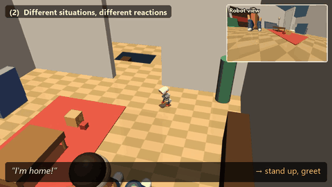
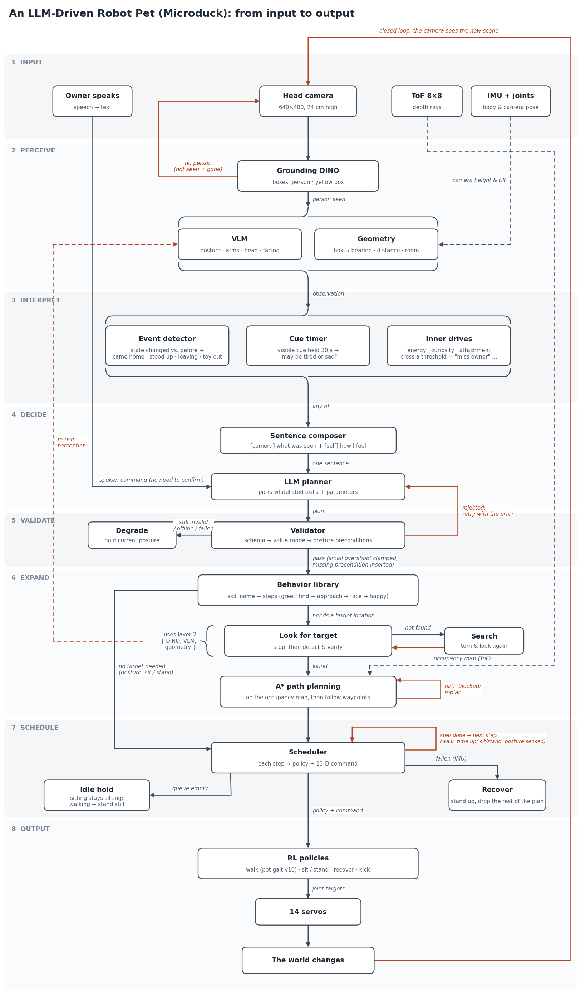

# An LLM-Driven Robot Pet (Microduck)

**A language-driven robot pet for [Microduck](https://github.com/pollen-robotics/microduck), a 25 cm bipedal robot.**
It watches its owner through a head camera, keeps track of its own energy and mood, and decides what to do by
choosing from a library of real dog and cat behaviors. An LLM plans, a validator checks, and RL policies move
the body. Everything runs in MuJoCo simulation.



▶ **Full video (3 min): [youtu.be/M3AWN9dTlrI](https://youtu.be/M3AWN9dTlrI)**

## Overview

Most "LLM controls a robot" demos turn commands into motions. A pet works differently: it acts **without being
told**, and what it does should mean something to the person it lives with. This project builds that layer on top
of the Microduck robot:

- the **owner** can talk to it, or simply come home, leave, sit down, or hold up a toy;
- the **robot** notices, considers its own state, and responds with a behavior a real pet would show;
- every behavior traces back to an **ethogram** grounded in animal-behavior research.

It is the first step toward companion and therapeutic robots that respond to how a person is doing, moving from
human-robot interaction (HRI) toward brain-robot interaction (BRI).

## Key features

**Behavior library built from an ethogram.**
26 dog and cat behaviors, each with an operational definition, a literature source, and a decision on whether this
body can perform it. Missing body parts get substitutes (no tail → a head wag), and behaviors whose trigger cannot
be sensed (petting) are left out. The ethogram defines the LLM's vocabulary and the requirements for the gait.
→ [docs/ethogram.md](docs/ethogram.md)

**LLM as planner, not end-to-end control.**
The LLM writes a short plan of named behaviors and simple steps (speed, turn rate, head angle); it never outputs
joint targets. A validator clamps values slightly out of range (up to 5x the limit), rejects values far beyond it, lets
the LLM retry once with the error, and otherwise holds the current posture. Failures can be traced to either planning
or execution.

**Inner drives.**
Energy, curiosity, missing the owner and nervousness drift over time. When one crosses a threshold, the robot calls
the planner on its own, without any command. The same situation leads to different choices: when the owner holds
up a toy, a rested robot invites play with a bow, while a tired one just stays close.

**Pet gait trained with RL.**
A custom walking policy for slow, pet-like movement, trained on the Microduck environment. The reward's tracking
tolerance scales with the commanded speed, so standing still no longer pays off when the robot is asked to walk
slowly. Pass criteria were fixed before training and checked across 3 seeds; the deployed policy is the one seed
that passed all main criteria.

## How it works



| Layer | What happens |
|---|---|
| Input | The owner's speech, or frames from the head camera |
| Perceive | Grounding DINO finds people and objects; a VLM and camera geometry describe the owner's posture and position |
| Interpret | Events (came home, leaving, holding a toy), long-lasting cues, and inner drives are composed into one sentence |
| Decide | The LLM plans a short sequence of behaviors |
| Validate | Out-of-range or unknown actions are clamped, retried or rejected |
| Expand | Behaviors that need a target find it, then plan a path with A* on an occupancy grid built from the ToF sensor |
| Schedule | Steps run in order; a fall triggers recovery and cancels the rest of the plan |
| Output | RL policies (walk, sit/stand, recover, kick) drive 14 servos |

## Results

All results are from simulation. A **held-out** set was written before its only run and never used to tune anything;
once its results led to a change, later runs of it count as development results. Each test is run 3 times
(LLM and VLM answers vary), and the counts below are passing runs.

**Gait** (`python -m gait.eval`; pass criteria fixed before training)

| Criterion | 7.4 V | 6.5 V |
|---|---|---|
| C1/C2 speed tracking, 0.05–0.4 m/s (0.48 s average within 0.02 + 10 %) | pass | pass |
| C3 start and stop within 0.48 s | pass (0.44 / 0.42 s) | **fail**: start 2.1 s, stop pass |
| C4 falls in 600 one-minute random scripts | 1 | 0 |
| C5 stands still at a zero command | pass | pass |
| C6 walks straight (≤ 1 deg/s drift) | **fail** (up to 8.4 deg/s) | **fail** (up to 5.3 deg/s) |
| C7 turns in place and while walking | pass | pass |

Against the walking policy trained with the upstream setup, tracking at 0.3–0.4 m/s rose from 50–58 % of the command
to 92 % (0.366 m/s at 0.4 in randomized training worlds). Of three training seeds, only the deployed one passed all
of the main criteria.

**Planner** (`python -m eval.commands`, `python -m eval.mood`)

| Set | Correct |
|---|---|
| Typed commands, development (20) | 60 / 60 |
| Typed commands, held-out 1 (6) | 14 / 18 |
| Typed commands, held-out 2 (6) | 11 / 18 ¹ |
| Emotion cues + inner state, development (11) | 33 / 33 |
| Emotion cues + inner state, held-out (6) | 15 / 18 |

¹ "Come here." chose *stay close* (walks to the owner and sits) where the test expected a plain walk; counting it,
14 / 18. "Turn left — no, wait, turn right." is a known limitation.

**Events from the camera alone** (`python -m eval.events`; small reaction ≤ 2 s, full event ≤ 5 s, no false alarms)

| Set | Correct | Latency |
|---|---|---|
| Development (6 scenarios) | 18 / 18 | reaction 0–0.5 s, event 1.5–3.5 s |
| Held-out 2 (8 scenarios), single held-out run | 21 / 24 | |
| Held-out 2, after the "toy in hands" rule change (development) | 23 / 24 | reaction 0.5–1.0 s, event 1.0–2.1 s |

**Owner state from one photo** (`python -m eval.owner_state`; four camera views not used while writing the
definitions, accuracy over 3 answers per photo)

| View | present | posture | arms | head | facing | consistency |
|---|---|---|---|---|---|---|
| standing, 1.2 m | 100 % | 88 % | 45 % | 30 % | 30 % | 85 % |
| standing, 1.8 m ² | 64 % | 64 % | 55 % | 45 % | 9 % | 91 % |
| standing, 1.5 m, 45° side | 100 % | 100 % | 58 % | 67 % | 39 % | 76 % |
| sitting, looking up, 0.9 m | 100 % | 88 % | 76 % | 79 % | 88 % | 91 % |

² For 4 of 11 poses the robot backs into the wall and sees no one. Hands, head and gaze are hard from a camera
24 cm above the floor; this is why events are confirmed over time and the robot looks up before acting on gaze.

**Behaviors with the camera** (held-out start positions): greeting the owner 8 / 8, investigating a toy 4 / 8.

**Navigation**: from an empty map, the robot reaches the goal in both test layouts without falling. Replanning only
when the path is blocked reduced replans from 118 to 42 and travel time from 79 s to 54 s.

## Limitations

- **Simulation only.** Nothing has run on the real robot yet.
- **Gait**: the training setup met all pass criteria in 1 of 3 seeds, and the deployed policy is that seed. It still
  drifts when walking straight (C6: up to 8 deg/s against a 1 deg/s limit) and starts slowly on a low battery
  (C3 at 6.5 V). It cannot walk backward, so the planner turns around instead.
- **Typed commands use the true owner position.** When you type a command, behaviors that need the owner read its
  position from the simulator. Only the camera-driven scenarios (the owner coming home, holding a toy, curling up)
  locate the owner from the head camera.
- **Perception**: Grounding DINO often ranks a small toy below larger objects; only the best match is checked when
  searching the floor, which causes most of the failed investigations. The VLM cannot tell a lowered head from hugged
  knees reliably, so "tired" and "sad" are treated as one cue.
- **The camera sees posture, not feelings.** The camera is 24 cm above the floor: from about 2 m it sees a standing
  owner only up to the waist, so it misses their face and anything held at the chest. The robot leans back and looks up
  before acting on whether the owner is looking at it, or before searching for a toy, but the watching loop does not
  look up yet, so a toy held up at the chest is often not noticed at all.
- **Corrections in one sentence** ("Turn left — no, wait, turn right") are not handled reliably.

## Roadmap

1. Read the owner's state better: voice and face, and mood over hours instead of seconds; when the owner is out of
   view, turn and look around for them while moving instead of only before.
2. Add signals a camera cannot see: physiological and brain signals (EEG, EMG).
3. Move to the real robot and evaluate with real people.

New sensors only need to produce cues for the Interpret layer; the planner, validator and scheduler stay the same.

## Repository layout

```
pet/            the robot pet (simulation)
  planner/      LLM planner: schema, prompts, validator, backward-walk expansion, preconditions, translation
  perception/   camera -> detector -> VLM -> owner state; event detection; the watching loop (sync and background)
  mind/         inner drives and long-lasting cues; asking the LLM in the background and re-checking premises
  body/         simulator wrapper, scheduler, keyframe gestures, ethogram behaviors, walk-to-target control
  nav/          search, occupancy grid, A*, ToF mapping, exploration, waypoints
  world/        stage props: the apartment edits and a scripted owner with known ground truth
gait/           pet-gait RL task (rewards, commands, config, tests), training entry point, pass criteria C1-C7
models/         policies trained in this project (pet gait, spin hop)
eval/           test sets with answers fixed in advance: commands, emotions, events, owner state
demos/          the showcase video and a live MuJoCo viewer
foundations/    PPO written from scratch (CartPole), before using a library PPO on the robot
docs/           ethogram, figures
```

## Getting started

Tested on Windows 11 with Python 3.12 and an 8 GB NVIDIA GPU (the GPU is only needed for Grounding DINO).

**1. The planner alone** (no simulator; needs an OpenAI API key):

```bash
pip install pydantic openai httpx
export OPENAI_API_KEY=...
python -m pet.planner.cli               # type a command, see the validated plan
python -m pet.planner.llm --selftest    # validator and retry logic, no API calls
```

**2. The full system in simulation.** Clone the upstream environment next to this repo and install it (follow its
README), then download the official policies:

```bash
git clone https://github.com/Hchenye0503/llm-robot-pet
cd llm-robot-pet
git clone https://github.com/pollen-robotics/microduck_rl ../microduck_rl
huggingface-cli download pollen-robotics/microduck-policies --revision d5a8b55 --local-dir ../microduck_rl/policies_official
pip install -r requirements.txt         # into the microduck_rl environment
export MICRODUCK_RL_DIR=../microduck_rl # optional when it sits next to this repo
```

```bash
python -m pet.body.scheduler --selftest # fixed plans in the simulator, no API calls
python -m demos.live                    # the owner comes home; watch in a MuJoCo window
python -m demos.showcase seg1           # record one segment of the showcase video to out/
```

Most modules have a selftest that needs neither the simulator nor the API, e.g. `python -m pet.nav.astar`,
`python -m pet.perception.events`, `python -m pet.mind.inner`.

**3. Evaluation and training**

```bash
python -m eval.commands --set dev -n 3  # typed commands against fixed answers
python -m eval.events --set dev         # event detection from the camera
python -m gait.eval --skip-c4           # pet gait pass criteria at 7.4 V and 6.5 V (CPU)
python -m gait.train --env.scene.num-envs 2048 --agent.seed 42   # retrain the pet gait (GPU)
python -m foundations.ppo_cartpole --selftest
```

## Acknowledgments

Built on [microduck_rl](https://github.com/pollen-robotics/microduck_rl) by Pollen Robotics (Apache-2.0), which
provides the robot model, actuator model, training environment and the official policies. The pet-gait task in
`gait/` extends that environment.
